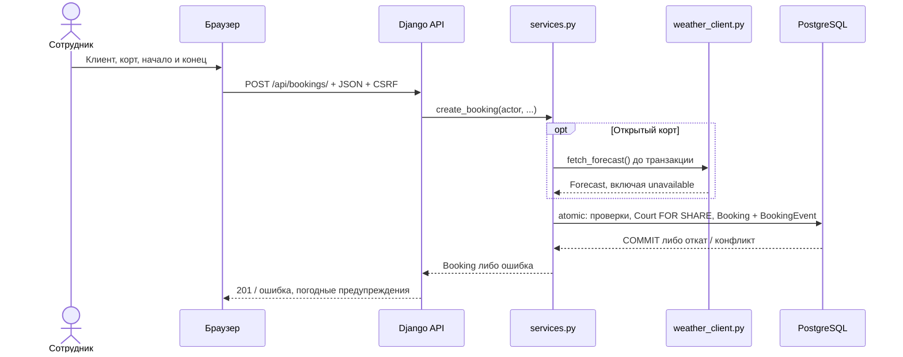

# Current system map — KazanCourts

Срез исходного кода: 28 октября 2026, ветка `task/homework-004-00-design-artifacts`, HEAD `0db4364b6dda1b78d35fe4e6e9039064719407bf`. Основание — чтение кода; новые проверки и сервисы при подготовке документа не запускались. Это описание фактов, без реконструкции исходных гипотез пользователя и без новых архитектурных решений.

## Facts

| Компонент | Подтверждённая ответственность и источник |
|---|---|
| Экран сотрудника | Django Templates: [`config/views.py`](../../config/views.py), `home()` → `home.html`; [`employee.js`](../../static/bookings/employee.js), `requestJSON()` и обработчики форм — загрузка данных и JSON-запросы. Вход через Django sessions; доступ требует активного сотрудника, изменяющие запросы защищены CSRF middleware. Источники: [`config/urls.py`](../../config/urls.py), [`settings.py`](../../config/settings.py), `MIDDLEWARE`; [`api.py`](../../bookings/api.py), `employee_booking()`. |
| Django JSON API | [`bookings/urls.py`](../../bookings/urls.py) и [`api.py`](../../bookings/api.py): чтение кортов, клиентов, расписания и истории; создание, перенос, отмена, архивирование, ручная перепроверка погоды и состояние покрытия. Формат входных данных проверяют формы из [`forms.py`](../../bookings/forms.py). |
| Правила и запись | [`services.py`](../../bookings/services.py): операции бронирования, блокировки, история; [`validators.py`](../../bookings/validators.py), `validate_booking_times()` — будущее время, шаг 10 минут, минимум час, предел «сейчас плюс календарный месяц» по Казани и сезон открытых кортов. |
| Данные PostgreSQL | [`models.py`](../../bookings/models.py): `Court` — корт и готовность покрытия; `Customer` — контакты; `Booking` — текущее состояние; `BookingEvent` — история с автором, временем, снимками `before`/`after` и причиной. История не является источником для восстановления состояния через event sourcing. |
| Погодная интеграция | [`weather_client.py`](../../bookings/weather_client.py), `fetch_forecast()` — синхронный адаптер Open-Meteo; [`weather_policy.py`](../../bookings/weather_policy.py) — чистый расчёт погодных блоков без БД и сети. В [`compose.yaml`](../../compose.yaml) определены `web` и `db`; Kafka, Outbox, publisher, consumer и автоматический scheduler в проверенном коде не реализованы. Это будущая архитектура Homework 004. |

## Booking sequence

Точный путь: [`api.py`](../../bookings/api.py), `create()` → `_write_booking()` / `BookingCreateForm` → [`services.py`](../../bookings/services.py), `create_booking()` → `_prepare_weather()` → `_create_booking()`.

Внутри `_create_booking()` повторно проверяются сотрудник, клиент с телефоном, время после получения блокировки, конфликт и погода. `_booking_weather()` запрещает недоступное покрытие и дождевой блок; `unknown` допускается с предупреждением, крытый корт получает `not_applicable`. Успех возвращается после выхода из транзакции.

## Current weather sequence

1. **Просмотр:** `GET /api/weather/?court_id=…&date=…` → [`api.py`](../../bookings/api.py), `weather()` → `fetch_forecast()` для открытого корта → `blocks_for_day()` → JSON. Записей предметных данных нет; для крытого корта адаптер не вызывается.
2. **Получение и расчёт:** [`weather_client.py`](../../bookings/weather_client.py), `fetch_forecast()` при выключенном `WEATHER_NETWORK_ENABLED` возвращает unavailable. При включённом флаге делает одну HTTP-попытку с timeout 5 секунд и `forecast_days=16`; `parse_forecast()` проверяет ответ. Ошибки преобразуются в unavailable без retry. [`weather_policy.py`](../../bookings/weather_policy.py), `blocks_for_day()` делит сутки `Europe/Moscow` на `[00,06)`, `[06,12)`, `[12,18)`, `[18,24)`: дождевые коды дают `blocked`, полностью известные часы без дождя — `clear`, иначе `unknown`; известный дождь имеет приоритет над пропусками. `blocks_for_interval()` и `interval_status()` оценивают весь интервал брони.
3. **Ручная перепроверка:** `POST /api/weather/recheck/` → [`api.py`](../../bookings/api.py), `weather_recheck()` → [`services.py`](../../bookings/services.py), `recheck_weather()`. Один прогноз получается до транзакции; `_recheck_weather()` обновляет будущие активные неархивные открытые брони и добавляет каждой `weather_checked`. Ответ содержит требующие внимания брони и контакты; автоматической отмены или реальной отправки уведомлений нет.

Текущее ограничение: `_recheck_weather()` безусловно присваивает рассчитанный `weather_status`; недоступный прогноз может заменить прежний `blocked` на `unknown`. `weather_checked_at` означает время попытки получения прогноза, включая ошибку, а не последнего успеха. Сохранение дождевого предупреждения при API-сбое и постоянный технический статус — согласованные будущие изменения, ещё не реализованные здесь.

## Transaction boundary

[`services.py`](../../bookings/services.py), `_booking_transaction()` использует `transaction.atomic()`; HTTP-запрос прогноза выполняется до него.

- Создание: `Booking` и ровно один `BookingEvent(created)` сохраняются вместе. Перенос, отмена и архивирование также сохраняют состояние и событие в одной транзакции (`_reschedule_booking()`, `cancel_booking()`, `archive_booking()`, `_record_change()`). Ошибка записи истории откатывает изменение брони.
- Перепроверка: вся выбранная группа броней и её события `weather_checked` входят в один `atomic()`. Брони блокируются `select_for_update()`, открытые корты — `FOR SHARE`; ошибка истории откатывает весь пакет.
- Покрытие: `close_surface()` и `_confirm_surface()` блокируют Court через `select_for_update(no_key=True)` и меняют его поля атомарно. `BookingEvent` для этих действий не создаётся. Физическая готовность покрытия независима от дождевого запрета.
- **Двойную бронь предотвращает PostgreSQL constraint `booking_active_no_overlap`**, описанный в [`models.py`](../../bookings/models.py), `Booking.Meta`, и [`миграции 0002`](../../bookings/migrations/0002_booking_no_overlap.py): одинаковый корт + пересечение `TSTZRANGE(..., '[)')` для `active` запрещены. Смежные интервалы допустимы. Предварительный `.exists()` и один `atomic()` не устраняют гонку; `_booking_transaction()` преобразует нарушение этого constraint (`23P01`) в HTTP 409. `FOR SHARE` координирует готовность покрытия и допускает параллельные бронирования.

Доказательства в тестах: [`test_booking_concurrency.py`](../../bookings/tests/test_booking_concurrency.py), `test_two_simultaneous_requests_leave_one_booking_and_event_repeatedly()` — два потока, barrier после свободных prechecks, разные PostgreSQL PID, ответы 201/409 и проверка одной брони/события на раунд; [`test_create_booking.py`](../../bookings/tests/test_create_booking.py), `test_api_history_failure_never_reports_success_or_keeps_booking()` — откат при сбое истории; [`test_weather_operations.py`](../../bookings/tests/test_weather_operations.py), `test_history_failure_rolls_back_the_entire_recheck_batch()` — откат пакета.

## Unknowns

- В этой задаче подтверждён исходный код, но не текущая схема и содержимое работающей БД. На этапе 0 прошли 145/145 тестов в существующем Compose-образе без пересборки; соответствие образа текущему дереву отдельно не сверялось. Новый прогон здесь не выполнялся.
- Реальная доступность и текущие ответы Open-Meteo не проверялись. По коду `unknown` объединяет ошибку API, выключенную сеть, неполные данные и выход за горизонт; устойчивого времени последнего успешного автоматического запроса пока нет.
- Текущий уровень изоляции PostgreSQL и применённость ограничений именно в development-БД в рамках этой карты не измерялись. Доказательство в исходниках и тестах не заменяет проверку конкретной запущенной среды.
