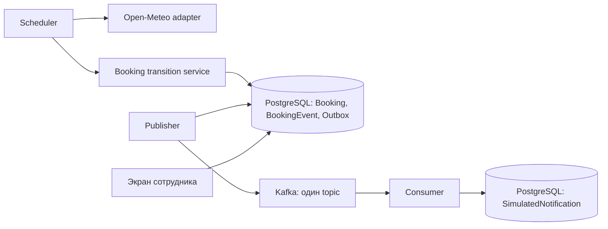
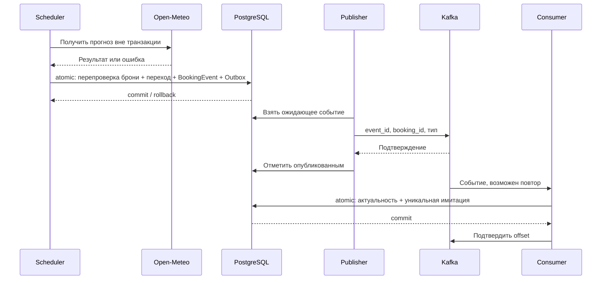

# System sequences — Draft

## Implemented: исходная цепочка

Текущие имена и границы подтверждены в [current-system-map.md](current-system-map.md): браузер → `bookings.api.create()` → `services.create_booking()` → `weather_client.fetch_forecast()` для открытого корта → `_create_booking()` → PostgreSQL (`Booking` + `BookingEvent` в одной транзакции). Ручная перепроверка вызывается `api.weather_recheck()` → `services.recheck_weather()`. Фоновой Kafka-цепочки в текущем коде нет.

## Planned: компоненты

## Planned: ухудшение / улучшение

При сбое погоды нет очищающего события; время последнего автоматического успеха и техническое состояние фиксируются отдельно. При повторе используется тот же `event_id`. Контракт, ограничения порядка и сбои — [kafka-design.md](kafka-design.md); будущие пути файлов/функций уточняются по фактической реализации этапа 4.
