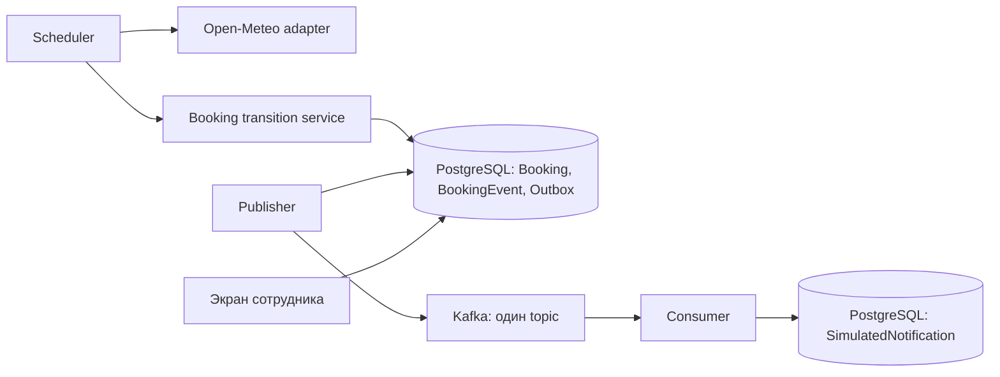
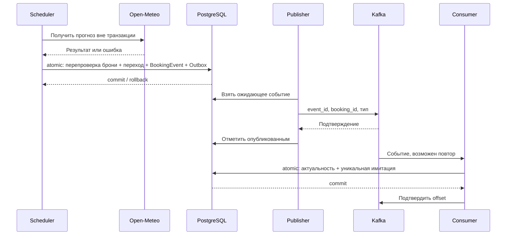

# System sequences — реализация Homework 004

## Implemented: исходная цепочка

Исходная цепочка: браузер → `bookings.api.create()` → `services.create_booking()` → `weather_client.fetch_forecast()` для открытого корта → `_create_booking()` → PostgreSQL (`Booking` + `BookingEvent` в одной транзакции). Ручная перепроверка вызывается `api.weather_recheck()` → `services.recheck_weather()`; теперь её надёжные погодные переходы тоже атомарно записывают системную историю и Outbox наряду с действием сотрудника. Ниже — фоновая цепочка этапа 4, объединённая в main; её проверка описана в [testing-report.md](testing-report.md).

## Реализация этапа 4: компоненты

## Реализация этапа 4: ухудшение / улучшение

При сбое погоды нет очищающего события; время последнего автоматического успеха и техническое состояние фиксируются отдельно. При повторе используется тот же `event_id`. Функции цепочки: `weather_scheduler.run_weather_check`, `weather_transitions.apply_weather_transition`, `kafka_pipeline.publish_pending` и `kafka_pipeline.process_notification` / `consume_one`. Контракт, ограничения порядка и сбои — [kafka-design.md](kafka-design.md).
